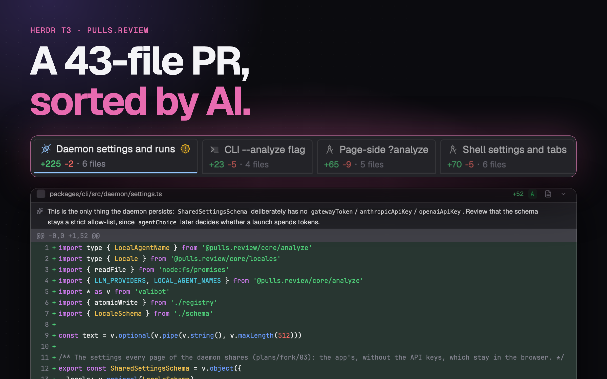

# pulls.review in Herdr App

English · [中文](README.zh-CN.md)

Two [Herdr App](https://herdr.dev) mods for [my fork](https://github.com/JinJieBeWater/pulls.review/tree/multi-repo) of [pulls.review](https://github.com/antfu/pulls.review) (its CLI is `jin.review`): `pulls-review`, a Review bar for your top bar that reviews the focused worktree, and `review`, the Review page of the window's side panel, where the review draws.



They are the optional Review extra of the [Herdr T3 layout](https://github.com/JinJieBeWater/herdr-t3), on their own.

The Review bar shows only what there is: `4 ahead of main` (the branch's commits not on the default branch, with `· merged?` once its upstream is gone), `3 uncommitted` (uncommitted files), `↑2` (commits your upstream doesn't have), `↓1` (commits from your upstream). Click one to review just that diff. Click the logo to search and pick something else: a commit of this branch (on the default branch, a recent one), or another local branch against the default branch. The logo stays when there are no counts. With the space's review on a diff, its count is lit and the logo's menu lists All changes and that diff's commits. It follows the focused pane (a pane with no folder: the terminals in its tab). The counts read your remote-tracking refs as they are: nothing is fetched for you.

Where a review opens is `open` in `mods/pulls-review/config.json`, a file you create (`{ "open": "pwa" }`); without it, `"herdr"`. The repo doesn't ship it, so an update never resets your pick:

- `"herdr"` (the default): on the Review page of the window's side panel (`mods/review/`), beside the panel's other pages, such as Files. The panel stays as you switch tabs and shows the current space: each space keeps its own review, and goes back to it after a restart. A click opens the panel on Review with that diff, the old one dimmed until the new one arrives; the header names what it reviews (`fix vs origin/main`; a branch against its upstream reads as the commits flow, `fix → origin/fix` to push or `origin/fix → fix` to pull) and its scope button, at the header's left as in T3 Code's diff panel, names what it reviews and picks another: Changes, Uncommitted, Outgoing, Incoming with their counts, or from its Commits submenu a commit of the branch; on Changes the base after `head →` is a button to pick another branch, local or remote, kept for the space; on one commit, its short SHA and `‹ ›` step through the branch's commits. Long lines wrap at the panel's edge; `Lines: Scroll` in its settings scrolls them sideways instead. Opened on a space with nothing picked yet, it shows the branch's Changes, as T3 Code's diff panel does (on a detached HEAD, the uncommitted changes). A space on another machine has no review: the daemon listens on this one only. The page follows changes in the worktree; out of sight (the panel closed or on another page, another space shown, or the window in the background) it waits, and catches up once shown. It shows the groups (the AI analysis, else rule-based ones), each group's summary, its files with their notes and highlighted diffs, unified or split, a whole file around its hunks, one commit at a time (picked in the Review bar) and reviewed marks, shared with the browser. An analysis runs with the local agent picked when you press Analyze; as the app never starts one by itself, analyzing on open is off until you turn it on, and even then an analysis of an older version waits for Re-analyze. As in the app, the analysis's state is the Analyze button's: while it runs or once it fails, the button opens what it's doing or why it failed. The settings gear picks automatic analysis, its agent, model and language, and unified or split diff. Its line-wrapping choice and file-tree width belong to Review alone; Files keeps its own settings and reading position. The groups form one row of tabs below the toolbar, with the selected group’s diff on the left and file tree on the right. Folders come before files at every level and names use natural order without case distinctions; the diff and next/previous file keys follow that order. A lone folder chain is one row, and the tree follows the file being read. The toolbar’s fold button expands or collapses all files, reviewed files or tests. Marking a file reviewed collapses it, and unmarking opens it. Split falls back to unified below 640px. Keys in the review: `j`/`k` next and previous file, `r` reviewed, `f` whole file, `c` collapse, `s` unified or split. Needs the fork, `jin.review` 0.3.4-fork.5 or later. Full review data is cached for only the three most recent spaces; older spaces retain reading choices and reload on return. Visible reviews refresh every 15s and catch up on return, without recursive folder watches.
- `"pwa"`: the fork's installed jin.review app (`jin.review -d --pwa`). Install the app first: run `jin.review -d` once, open the page in Chrome, install it as an app and allow it to open `web+pullsreview` links.
- `"browser"`: the fork in the browser (`jin.review -d`).
- `"official"`: the `pulls.review` CLI. Each worktree gets its own server, which herdr-core keeps running in the background (`hc ls --label pulls-review.root=<folder>`; stop one with `hc kill <address>`). The first open signs the browser in; later ones open a new tab on the same server.

With `"pwa"` or `"browser"`, a click on a count also starts the diff's AI analysis, or follows the one already running. A pick from the logo's menu doesn't. In `"herdr"` the review's own setting decides, as above.

In `"herdr"` mode the current space's analysis shows after the Review bar's logo, with an agent's marks: a spinner while it runs; if it ended while you weren't looking at that space's Review page, a dot when it finished or `!` when it failed, until you look. Herdr T3's panel head marks its Review tab the same way, and with `toggle` (below) the mark sits inside the panel's toggle, left of its icon, while the panel is closed. It isn't an agent, so it stays out of the agents list and Inbox.

## Install

1. Install one pulls.review CLI on Herdr's `PATH`: `bun add --global jin.review` for the fork (it installs next to `pulls.review`; one background server for every repo, stopped with `jin.review --stop`), or `bun add --global pulls.review` for `"official"`.
2. Ask your Herdr agent to add `herdr.dev/mods/JinJieBeWater/herdr-pulls-review`, or copy `mods/pulls-review/` and `mods/review/` into `~/.config/herdr-app/mods/`. They are a pair: the Review page draws the review, the bar picks what it shows. To open reviews other than in Herdr, create `mods/pulls-review/config.json` (above).
3. Put the bar in your layout's top bar: a block in a `row` with `"resizable": false`, the block's own `id` in `props.block`. The bar sizes that block to itself, to nothing outside a repository:

   ```json
   { "id": "review-bar", "type": "block", "size": { "px": 0 }, "window_drag": true,
  "content": { "mod": "pulls-review", "props": { "block": "review-bar" } } }
   ```

   In [Herdr T3](https://github.com/JinJieBeWater/herdr-t3) it goes in the `tabs-row` row, right before `tabs-end`, with `"toggle": true` in its props: the bar is then the panel's toggle alone, in place of the logo (the logo is the panel's Review tab): no counts and no git reads for them, the analysis's mark inside it left of its icon while the panel is closed; pick another diff from the Review page's scope menu, which counts each scope. Herdr T3's `scripts/update.sh` sets it. `"herdr"` needs this block, the only place to pick another diff. `"mod.open:pulls-review"` in `keys.json` also reviews the focused worktree. Don't give the bar the id `review`: that's the Review page's (step 4), and an id may appear only once in a layout.
4. For `"herdr"`, add the Review page to your layout's side panel, at the end of its `panel-body` stack: `{ "id": "review", "type": "block", "content": { "mod": "review" } }`. Herdr's own main layout has that stack, holding `files` and `changes`; in Herdr T3, `scripts/update.sh` adds the page by itself once the extra is installed. A click on a count shows the panel on this page.
5. For the review's analysis, pick a local agent once, with the gear in the review's header or in the browser's review settings (`jin.review -d`): the daemon keeps that choice.

## Update

Herdr doesn't update mods from others, and adding them again installs renamed copies, since an install never overwrites. Overwrite `mods/pulls-review/` and `mods/review/` with the repo's latest instead (tell your Herdr agent, or copy the files), then run `herdr-app check` on each. Kept: your `config.json`, which the repo doesn't ship, and the review's settings, which live in `shared.json`. If your layout still names the bar's block `review`, from before the Review page, rename it and its `props.block` to `review-bar` first.

## What it runs

- Local folders only: on another machine the bar shows nothing and the Review page says why.
- Read-only git (`git status`, `git rev-parse`, `git symbolic-ref`, `git log`, `git for-each-ref`, `git rev-list`) and `pulls.review` or `jin.review`; the Review page talks to the jin.review daemon on `127.0.0.1` with the session it keeps in `~/.pulls.review`, and starts it when it isn't running.

## Develop

`node mods/pulls-review/check.cjs` and `node mods/review/check-pane.cjs` run each mod without a window; `herdr-app check mods/<name>` loads it in Herdr. The mods are made in [herdr-t3](https://github.com/JinJieBeWater/herdr-t3)'s `extras/mods/` and copied here; send changes there.

## License

Apache-2.0, as Herdr App. The pulls.review logo, the Lucide icons, the Catppuccin file icons and the character-width table from get-east-asian-width keep their own licenses, in each `NOTICE`.
