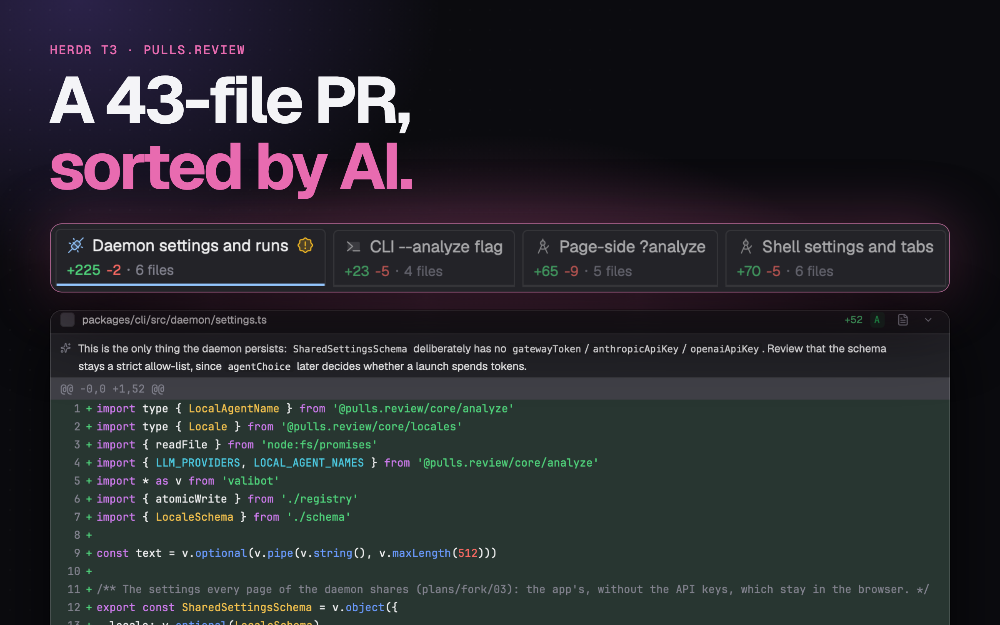

# 在 Herdr App 里用 pulls.review

[English](README.md) · 中文

给 [pulls.review](https://github.com/antfu/pulls.review) 的[我的 fork](https://github.com/JinJieBeWater/pulls.review/tree/multi-repo)（CLI 叫 `jin.review`）配套的两个 [Herdr App](https://herdr.dev) mod：`pulls-review` 是放在顶栏里的 Review 栏，评审当前焦点所在的工作树；`review` 是窗口侧边面板里的 Review 页，评审显示在这里。



它们就是 [Herdr T3 布局](https://github.com/JinJieBeWater/herdr-t3)里可选的 Review 扩展，单独拿出来。

Review 栏只显示有的内容：`4 ahead of main`（当前分支上默认分支没有的提交；上游分支已删除时附带 `· merged?`）、`3 uncommitted`（未提交的文件数）、`↑2`（上游还没有的提交）、`↓1`（上游新增的提交）。点击只看那一份 diff。点击 logo 可以搜索并选别的：当前分支的某个提交（在默认分支上是最近的提交），或者其他本地分支与默认分支的对比。没有计数时 logo 也会保留。当前 space 的评审正显示某份 diff 时，对应的计数会高亮，logo 菜单列出 All changes 和这份 diff 的提交。它跟随当前焦点窗格（没有目录的窗格取同一标签里终端的目录）。这些计数读取现有的远程跟踪引用，不会替你 fetch。

评审在哪里打开，由 `mods/pulls-review/config.json` 里的 `open` 决定。这个文件由你自己新建（`{ "open": "pwa" }`），没有时就是 `"herdr"`。仓库不带它，所以更新不会重置你的选择：

- `"herdr"`（默认）：在窗口侧边面板的 Review 页打开（`mods/review/`），和面板的其他页（比如 Files）并列。面板在切换标签时保持不动，显示当前 space：每个 space 各有自己的评审，重启后回到原来那份。点击会打开面板的 Review 页并换成那份 diff，新的到来前旧的变暗显示；顶栏写明在评审什么（`fix vs origin/main`；分支与其上游的对比按提交流向写，要推送是 `fix → origin/fix`，要拉取是 `origin/fix → fix`），顶栏左边的范围按钮照 T3 Code 的 diff 面板，写着在评审什么，点开可以换：Changes、Uncommitted、Outgoing、Incoming（带数量），或者从 Commits 子菜单选当前分支的某个提交；在 Changes 下，`head →` 后面的 base 是一个按钮，可以换成别的本地或远程分支，每个 space 各记一份；看某个提交时，后面显示短 SHA，用 `‹ ›` 在这个分支的提交之间前后走。长行默认在面板边缘自动换行；设置里选 `Lines: Scroll` 改为横向滚动。在还没选过的 space 打开时，照 T3 Code 的 diff 面板显示当前分支的 Changes（detached HEAD 时显示未提交的改动）。其他机器上的 space 没有评审：daemon 只在本机监听。Review 页会跟随工作树的改动；看不见时（面板关着或在别的页、显示的是别的 space，或窗口在后台）先不更新，重新显示后再补上。页面里有：分组（有 AI 分析时用它，否则用规则分组）、每组的摘要、组内文件及其注释和带语法高亮的 diff（统一或分栏）、围绕改动显示整个文件、逐个 commit 查看（在 Review 栏里切换），以及和浏览器共用的已看标记。点 Analyze 时用选好的本地 agent 分析；和网页端一样不会自己开始分析，打开时自动分析默认关闭，开启后遇到针对旧版本的分析也会等你点 Re-analyze。和网页端一样，分析状态显示在 Analyze 按钮上：分析中或失败时，点按钮查看进度或失败原因。评审顶栏的齿轮里设置自动分析、agent、模型、语言和统一或分栏视图。换行和文件树宽度只属于 Review，Files 各记自己的设置与阅读位置。工具栏下面是一行分组页签，当前组的 diff 在左，文件树在右。文件树每层先目录后文件，名称忽略大小写、数字按数值排；diff 和前后文件快捷键沿用相同顺序。只含一个文件夹的链合成一行，树跟随正在阅读的文件。工具栏的折叠按钮可以展开或折叠全部文件、已看文件或测试文件；标记已看会折叠，取消标记会展开。diff 窄于 640px 时分栏退回统一视图。快捷键：`j`/`k` 下一个、上一个文件，`r` 标记已看，`f` 整个文件，`c` 折叠，`s` 切换统一或分栏。需要 fork 的 `jin.review` 0.3.4-fork.5 或更新版本。
- `"pwa"`：在已安装的 jin.review 应用里打开（`jin.review -d --pwa`）。先安装应用：运行一次 `jin.review -d`，在 Chrome 打开该页面，安装为应用，并允许它打开 `web+pullsreview` 链接。
- `"browser"`：用 fork 在浏览器里打开（`jin.review -d`）。
- `"official"`：`pulls.review` CLI。每个工作树一个服务，由 herdr-core 在后台托管（`hc ls --label pulls-review.root=<目录>` 查看，`hc kill <address>` 停止）。第一次打开时浏览器完成登录，之后在同一个服务上打开新标签页。

用 `"pwa"` 或 `"browser"` 时，点击计数还会开始这份 diff 的 AI 分析；已有分析在跑就直接接上。从 logo 菜单里选的不会。`"herdr"` 模式下由评审自己的设置决定，见上文。

`"herdr"` 模式下，当前 space 的分析状态用 agent 的标记显示在 Review 栏 logo 后面：运行中转圈；如果结束时你没在看那个 space 的 Review 页，完成显示圆点、失败显示 `!`，看过后消失。Herdr T3 的面板顶栏在 Review 页签上也这样标记；带 `toggle`（见下）时，面板关着期间这个标记放在面板开关里、图标左边。它不是 agent，所以不进 agents 列表和 Inbox。

## 安装

1. 在 Herdr 的 `PATH` 里装一种 pulls.review CLI：那个 fork 用 `bun add --global jin.review`（可与 `pulls.review` 同时安装；所有仓库共用一个后台服务，用 `jin.review --stop` 停止），`"official"` 用 `bun add --global pulls.review`。
2. 让你的 Herdr agent 添加 `herdr.dev/mods/JinJieBeWater/herdr-pulls-review`，或者把 `mods/pulls-review/` 和 `mods/review/` 复制进 `~/.config/herdr-app/mods/`（两者配套：Review 页负责绘制评审，Review 栏负责选择显示什么）。不想在 Herdr 里打开评审的话，新建 `mods/pulls-review/config.json`（见上文）。
3. 把 Review 栏放进布局的顶栏：放在一个 `"resizable": false` 的 `row` 里，块自己的 `id` 写进 `props.block`。Review 栏会把这个块调整到自己的宽度，不在仓库里时缩到 0：

   ```json
   { "id": "review-bar", "type": "block", "size": { "px": 0 }, "window_drag": true,
  "content": { "mod": "pulls-review", "props": { "block": "review-bar" } } }
   ```

   在 [Herdr T3](https://github.com/JinJieBeWater/herdr-t3) 里，放进 `tabs-row` 这一行、`tabs-end` 前面，props 里带 `"toggle": true`：这时 Review 栏只是面板开关，代替 logo（logo 在面板的 Review 页签上）：没有计数，也不为计数读 git，面板关着时分析状态放在开关里、图标左边；要换一份 diff，用 Review 页顶栏的范围菜单，那里有各范围的数量。Herdr T3 的 `scripts/update.sh` 会自动加上。`"herdr"` 模式必须放这个块，换一份 diff 只能在这里操作。也可以在 `keys.json` 里绑定 `"mod.open:pulls-review"`，按键评审当前工作树。不要把这个块的 id 设成 `review`：那是 Review 页的（第 4 步），一个布局里的 id 不能重复。
4. 用 `"herdr"` 模式时，把 Review 页加进布局侧边面板 `panel-body` 这个 stack 的末尾：`{ "id": "review", "type": "block", "content": { "mod": "review" } }`。Herdr 自带的 main 布局有这个 stack，里面是 `files` 和 `changes`；在 Herdr T3 里，装好扩展后 `scripts/update.sh` 会自己加上。点击计数就会把面板切到这一页。
5. 要分析评审，先选一次本地 agent：用评审顶栏的齿轮，或浏览器里的评审设置（`jin.review -d`），daemon 会记住这个选择。

## 更新

Herdr 不会更新别人做的 mod，再添加一次只会装出改了名的副本，因为安装从不覆盖。更新要用仓库最新的文件覆盖 `mods/pulls-review/` 和 `mods/review/`（让 Herdr agent 做，或者手动复制），再对两者跑 `herdr-app check`。会保留：你的 `config.json`（仓库不带这个文件），以及存在 `shared.json` 里的评审设置。如果布局里 Review 栏的块还叫 `review`（Review 页出现之前的写法），先把它和 `props.block` 一起改成 `review-bar`。

## 会运行什么

- 只支持本机目录：在其他机器上 Review 栏不显示，Review 页说明原因。
- 只读的 git（`git status`、`git rev-parse`、`git symbolic-ref`、`git log`、`git for-each-ref`、`git rev-list`）和 `pulls.review` 或 `jin.review`；Review 页通过 `~/.pulls.review` 里保存的会话访问 `127.0.0.1` 上的 jin.review daemon，daemon 没在运行时会启动它。

## 开发

`node mods/pulls-review/check.cjs` 和 `node mods/review/check-pane.cjs` 不开窗口就能跑通各个 mod；`herdr-app check mods/<name>` 在 Herdr 里加载它。这两个 mod 在 [herdr-t3](https://github.com/JinJieBeWater/herdr-t3) 的 `extras/mods/` 里开发，再复制到这里；要改请提到那边。

## 许可

Apache-2.0，和 Herdr App 一样。pulls.review 的 logo、Lucide 图标、Catppuccin 文件图标和来自 get-east-asian-width 的字符宽度表沿用各自的许可，见各个 `NOTICE`。
