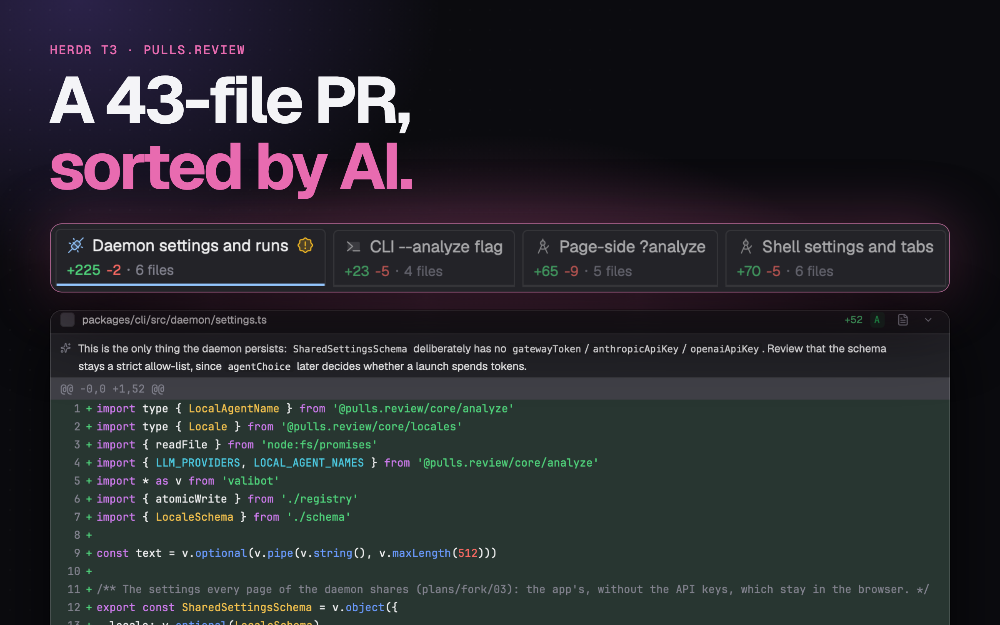

# pulls.review in Herdr

A Review bar for Herdr App's top bar and a review pane beside the agent: the bar counts what there is to review in the focused worktree (the branch's commits past the default branch, uncommitted files, commits to push and to pull), a click on a count reviews that diff, and the review draws natively in a pane, grouped and highlighted, from the pulls.review fork's `jin.review` daemon. The pane's tab and header show its AI analysis with an agent's marks.

## What you see

- **Review bar** (`mods/pulls-review`, 24px tall, in a block of a 40px top bar): one 1px `border` outline, radius 6, its parts ruled apart by 1×14px `border` lines: a 14px pulls.review logo in its own colors (5px each side), then only the counts there are, 12px `dim` text with the number `font_medium` in its own color, 8px each side: `4 ahead of main` (`ansi4`; `· merged?` once the upstream is gone), `3 uncommitted` (`ansi3`), `↑2` (`ansi2`), `↓1` (`ansi1`). No fill at rest; a part hovered fills `hover` to the outline, its text and icon `foreground` and its number the bright twin (`ansi` + 8). Each part has a hover label, as Herdr T3's: what it does. In Herdr T3's keyboard mode the logo and each count are Tab stops (`focus.js`, a copy of Herdr T3's), as the Actions control beside them, Enter or Space doing what a click does. 8px after it, before what follows in the bar. Outside a git repository, or on another machine, nothing: its block is 0 wide.
- With `shared("bar.compact")` true (Herdr T3's bar sets it under 1024px; unset elsewhere), the counts drop their words: `4 | 3 | ↑2 | ↓1`, and the hover label of a count that lost words gives them back (`4 ahead of main · merged?`).
- **Branch menu** (560px popup hanging from the bar under the click, at y 40): a search field, then a switch between two pages, `Commits 24` and `Branches 4` (each counting what the search leaves; the page shown `selected`; a click or Tab turns it; a search that empties the page shown and not the other turns to the other), with what the page lists at its right in `dim` (`in this review`, `on <branch>`, `vs main`); one page alone has its title instead. The Commits page has `All changes` on top while the pane shows a diff, then its commits (one line each, as VS Code's quick pick: a conventional prefix in `dim`, the subject, then `↑` in green for a commit not on the upstream yet and the age as the Inbox's, `now`, `25m`, `2h`, `3d`; no sha shown, though a sha's start still finds its commit; hovered, a card as an Inbox row's, with its timing, on the row's left since the menu hangs at the window's right: the whole subject, wrapped, then when to the minute, the author, and whether the upstream has it). The Branches page has a branch icon, the name, its last commit's subject in `dim`, `N ahead` and the age; hovered, a card as a commit's: the name, the last commit's subject, when, its author, `N ahead of main, M behind`, how it stands against its upstream (`2 not pushed · origin/x`, `Up to date with origin/x`, gone, or none) and the worktree it's checked out in. The switch and All changes sit outside the list; 32px rows; the popup is as tall as the longer page, so turning pages doesn't resize it. As the layout's New and Go to, one row is highlighted (`selected`): the top one first and again after each keystroke in the search, moved by the pointer or ↑/↓ (round at the ends), opened by Enter; the rest lift faintly under the pointer (`foreground` at 4%). What the review pane shows has a check at its row's end. Each page's list scrolls by script, as Herdr's picker: only the rows in view are drawn, where the scroll puts them (a virtual list scrolls from code but its rows can't open a card); ↑/↓ scroll the highlight into view, and the wheel takes the highlight along to the nearest row in view.
- **Review pane** (`mods/review`, a pane split right of the agent, or a tab of its own): a 40px header (counts, a reviewed donut, Analyze, fold and settings buttons), groups as tabs or a sidebar, from 1024px an aside with the group's files, and the diff, unified or split, with notes from the analysis.

## How it behaves

- The bar follows the focused pane (a review pane: the terminals in its tab). It reads git on a new location, on a change in the worktree, else every 10 s; switching back shows the last read at once. Nothing is fetched.
- A count's click opens that diff; with `"pwa"` or `"browser"` it also starts its AI analysis (or follows the one running). The logo opens a menu, closed by a second click, that picks a commit or a branch without analyzing. Enter in its search opens the top row. While the pane shows a diff, its count has a `hover` fill and, with one commit shown, `‹ Commit 3 of 54 ›` follows the counts: the arrows step through the commits, the middle opens the menu.
- Where a review opens is `open` in `mods/pulls-review/config.json`: `herdr` (the pane), `pwa`, `browser` or `official` (the upstream CLI, one server per worktree kept by herdr-core). The person creates that file; without it, `herdr`. The repo ships none, so overwriting the mods on an update keeps their pick.
- In the pane: `j`/`k` next and previous file, `r` reviewed, `f` whole file, `c` collapse, `s` unified or split. Analyze shows `Analyzing…` from the click; its tab and the pane header show a spinner while it runs, and if it ended while another tab was shown, a `done` dot or a `blocked` `!` until the tab is looked at. In the pane a failure stays on the button. The settings' Language, Agent and Model each save only their own field: the daemon's PUT replaces every setting, so a save reads the latest settings, merges its field and PUTs, queued behind the save before it; another pane's change, or this pane's own a moment before, stays. Reviewed marks (`r` or a click) go one at a time in the order pressed, so marking then unmarking quickly keeps the last press.

## Built from

- `mods/pulls-review/main.js`: one mod, three roles by `props()`: in a layout block the bar (`bar.js`); `{ menu: "review", … }` the branch menu; any other overlay (`mod.open`) opens a review (`open.js`) and closes itself (`frame: "none"`, 1×1). The bar calls `open.js` itself.
- The bar sizes its own block: `on_size_change` on a `flex_none` wrapper reports its full width even when the block is narrower; divided by `settings().zoom` (it reports zoomed pixels), it goes to `run("layout.resize", { id: props().block, px })`, only when it changed.
- `herdr` mode: `pane.split { direction: "right", mod: "review", props: { root, page, n } }`, or `tab.new { mod: "review" }`; a pane already open gets the page through `shared("review")`.
- `mods/review/daemon.js` reads `~/.pulls.review/daemon.pid` and calls the daemon's `/api/review*` routes ([the fork's plan](https://github.com/JinJieBeWater/pulls.review/blob/multi-repo/plans/fork/04-herdr-review-pane.md)), starting it with `jin.review -d --no-open --worktree`. The pane shares `review.titles`, `review.program` and `review.status` (per tab) for headers and tabs that read them, as Herdr T3's do.
- Programs: `git` (read-only, `--no-optional-locks -c core.fsmonitor=false`), `jin.review` or `pulls.review`, `hc` for `official`. Icons: Herdr's `mods/workspace-chrome/*`, Lucide (`mods/review/icons`) and catppuccin file icons (`mods/review/icons/cat`).
- `mods/review/main.js` holds the pane's state, lifecycle and top-level render; each concern has its file: `review-load.js` (reading and polling the daemon), `header.js`, `commits.js`, `groups.js`, `files.js`, `diff.js`, `settings.js`, `keys.js`, and `controls.js` for the controls they share. `rows.js` lays out a diff's rows.

## Watch out

- `layout.resize` doesn't reach a block in a floating window's layout: there the bar keeps the block's size.
- The block's row needs `"resizable": false`: rows default to resizable, and a drag would fight the block sizing itself.
- A layout naming `pulls-review` without the folder installed reports `no mod folder` in `herdr-app status`.
- Herdr tells a mod pane neither its tab nor its folder: the pane claims the one review pane's tab no other has, and the bar takes a mod pane's folder from the terminals in its tab.
- A review picked from the logo's menu loads as one from a count does: the review pane starts its first read on its own 0ms timer (`cx.timer.after(0, …)` in `init`). The pane is made as the menu closes, and a read started in `init` itself then never answers and times out after 30s.
- The analysis start is fire-and-forget on the daemon: the pane shows running for up to 10 s before the first read sees the run.

## Done when

- `node mods/pulls-review/check.cjs` and `node mods/review/check-pane.cjs` print `ok`; `herdr-app check mods/pulls-review` and `mods/review` pass.
- In a repository with a branch past main, the bar shows `N ahead of main` and its block is exactly as wide as the bar plus 8px; in a folder that isn't a repository the block is 0 wide.
- Clicking a count opens the review pane beside the focused pane with that diff, and Analyze turns the pane's tab spinner on.
