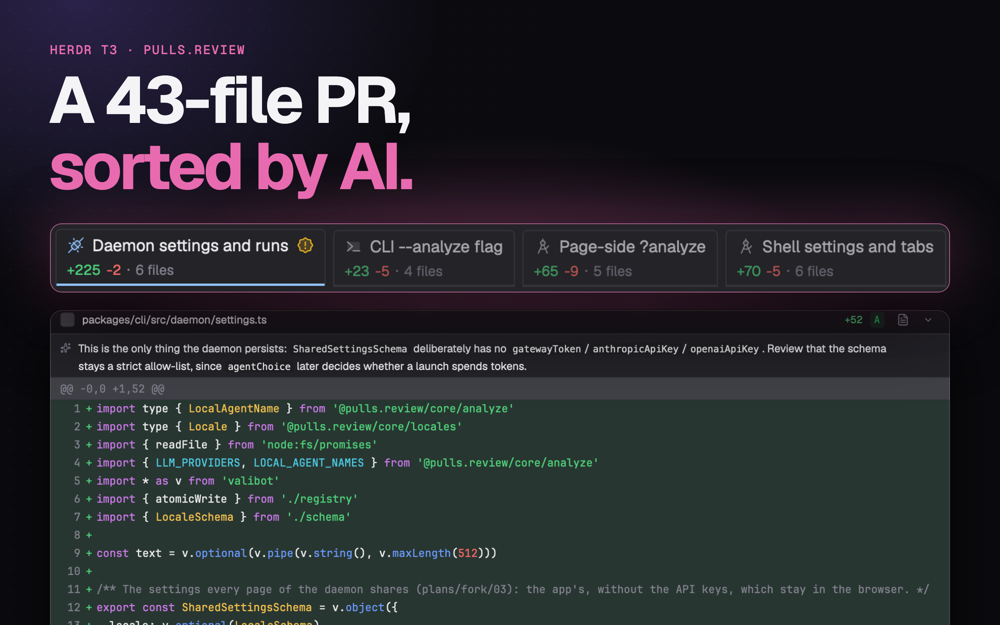

# pulls.review in Herdr

A Review bar for Herdr App's top bar and a Review page in the window's side panel: the bar counts what there is to review in the focused worktree (the branch's commits past the default branch, uncommitted files, commits to push and to pull), a click on a count reviews that diff, and the review draws natively on the panel's Review page, grouped and highlighted, from the pulls.review fork's `jin.review` daemon. One page serves every space and shows the current space's review. The space's AI analysis shows after the bar's logo with an agent's marks.

## Where it's specified

`mods/pulls-review` and `mods/review` are the [Herdr T3 layout](https://github.com/JinJieBeWater/herdr-t3)'s Review extra, copied here by its `scripts/sync.sh`. The page's look and behaviour (toolbar, range and base menus, group tabs, tree, diff, settings) are herdr-t3's [review spec](https://github.com/JinJieBeWater/herdr-t3/blob/main/docs/internals/specs/review.md), its tree rows the [Files spec](https://github.com/JinJieBeWater/herdr-t3/blob/main/docs/internals/specs/files.md#tree-rows), and its controls the [visual tokens](https://github.com/JinJieBeWater/herdr-t3/blob/main/docs/internals/t3-tokens.md); change them there. What follows is only how the two mods sit in a layout of your own.

## In a layout

- **The bar** (`mods/pulls-review`, `"place": "none"`): a top-bar block, `{ "mod": "pulls-review", "props": { "block": "<the block's id>" } }`, in a row with `"resizable": false`. It sizes that block itself (`layout.resize` with `props().block`): the counts there are and the logo, plus 8px; outside a git repository, or on another machine, 0 wide. With `toggle` in its props it is only the space panel's toggle and reads no git. Its id can't be `review`, the page's; Herdr T3 names it `review-bar`.
- **The page** (`mods/review`): a `review` block in the side panel's `panel-body` stack. A count's click writes `shared("review")` (`{ space, root, page, n, analyze }`) and shows that page (`layout.select` on `panel-body`, `layout.show` on `panel`); with no `review` page in the layout it says so in a toast.
- **Where a review opens** is `open` in `mods/pulls-review/config.json`: `herdr` (the panel's page), `pwa`, `browser` or `official` (the upstream CLI, one server per worktree kept by herdr-core). The person creates that file; without it, `herdr`. The repo ships none, so overwriting the mods keeps their pick.
- Without Herdr T3's bar nothing sets `shared("t3-tabs.compact")`: the counts always show their words.
- `mods/review/daemon.js` reads `~/.pulls.review/daemon.pid` and calls the daemon's `/api/review*` routes ([the fork's plan](https://github.com/JinJieBeWater/pulls.review/blob/multi-repo/plans/fork/04-herdr-review-pane.md)), starting it with `jin.review -d --no-open --worktree`. Programs: `git` (read-only, `--no-optional-locks -c core.fsmonitor=false`), `jin.review` or `pulls.review`, `hc` for `official`.

## Watch out

- `layout.resize` doesn't reach a block in a floating window's layout: there the bar keeps the block's size.
- A layout naming `pulls-review` without the folder installed reports `no mod folder` in `herdr-app status`; a stack whose block names a missing mod shows an error on that page. Add the `review` block only where `mods/review` is.
- Herdr tells a mod pane no folder: the bar takes one from the terminals in its tab.
- The analysis start is fire-and-forget on the daemon: the review shows running for up to 10 s before the first read sees the run.

## Done when

- `node mods/pulls-review/check.cjs` prints `ok`; `herdr-app check mods/pulls-review` and `mods/review` pass.
- In a repository with a branch past main, the bar shows `N ahead of main` and its block is exactly as wide as the bar plus 8px; in a folder that isn't a repository the block is 0 wide.
- Clicking a count opens the panel on its Review page with that diff, the diff on the left and its groups and files on the right; Analyze puts the spinner after the bar's logo. Another space shows its own review, and a space on another machine says it has none.
